<div align="center">

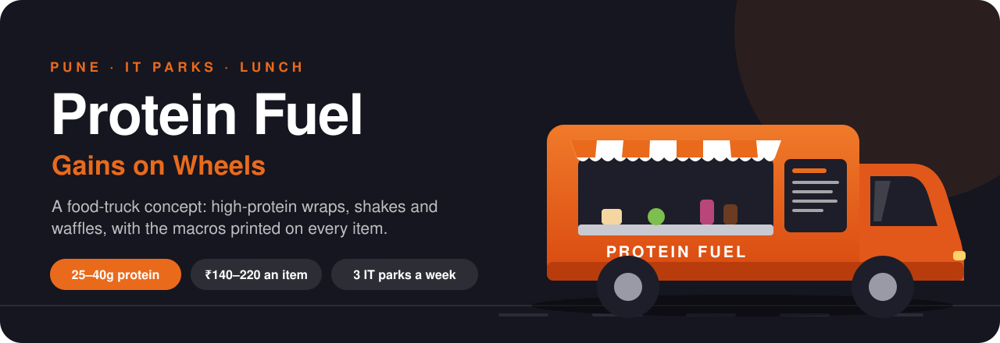

<br/>

[](https://v0-protein-fuel.vercel.app)


**[The problem](#01--the-problem)** ·
**[The concept](#02--the-concept)** ·
**[The menu](#03--the-menu)** ·
**[The route](#04--the-route)** ·
**[The site](#05--the-site)** ·
**[Where it stands](#07--where-it-stands)** ·
**[Run it](#09--run-it-yourself)**

</div>

---

> **Protein Fuel is an idea, not a business yet.** The site is the pitch: a brand, a menu, a route and an ordering flow you can click through. No truck is on the road, no orders are taken, and nothing is charged.

---

## 01 · The problem

Lunch in Pune's IT parks tends to come in three kinds: fast and heavy, healthy and bland, or good but forty minutes away. People who train, or who just want to stay sharp after lunch, often end up eating a protein bar at their desk.

## 02 · The concept

**A food truck that brings tasty, high-protein lunch to the office park.** It serves three things, done well: wraps, shakes and waffles. Every item lists its protein and calories, and the truck parks at a different IT park each weekday.

| What it bets on | How |
|---|---|
| **Protein first** | Every item is built around 25–40g of protein, and the number is on the menu |
| **Tasty, not virtuous** | Food people already want (wraps, shakes, waffles), rebuilt to be good for them |
| **Go to the crowd** | A truck can follow lunch demand across three parks instead of waiting in one spot |
| **Pre-order to beat the rush** | Order from the desk, pick a slot, skip the queue at 1 PM |

<div align="center">
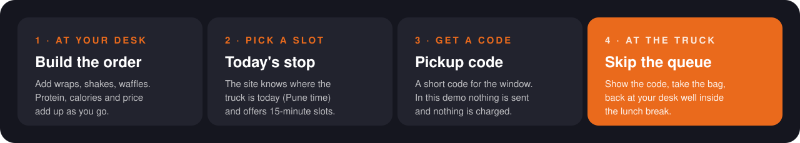
</div>

## 03 · The menu

Nine items. Prices run from ₹140 to ₹220 and protein from 25g to 40g. The last column is the number that matters to a gym-goer: grams of protein for every ₹100.

| | Item | What's in it | Protein from | Protein | kcal | Price | Per ₹100 |
|---|---|---|---|---|---|---|---|
| Wraps | Chicken Power Wrap | Grilled chicken breast, mixed greens, tomato, cucumber, protein mayo | Chicken | **40g** | 450 | ₹220 | 18.2g |
| | Paneer Tikka Wrap | Tandoori paneer, bell peppers, onions, mint chutney | Paneer | **35g** | 420 | ₹200 | 17.5g |
| | Tofu Delight Wrap | Marinated tofu, avocado, sprouts, hummus, multigrain wrap | Plant-based | **32g** | 380 | ₹180 | 17.8g |
| Shakes | Chocolate Fuel | Whey protein, banana, cocoa, almond milk, dates | Whey | **30g** | 320 | ₹180 | 16.7g |
| | Berry Blast | Mixed berries, whey protein, Greek yogurt, honey | Whey | **28g** | 290 | ₹170 | 16.5g |
| | Green Machine | Spinach, pea protein, mango, chia seeds, coconut water | Plant-based | **25g** | 260 | ₹150 | 16.7g |
| Waffles | Classic Berry Waffle | Protein waffle, Greek yogurt, mixed berries, honey drizzle | Protein batter | **25g** | 350 | ₹170 | 14.7g |
| | Chocolate Dream | Chocolate protein waffle, peanut butter, banana slices | Protein batter | **27g** | 380 | ₹160 | 16.9g |
| | Savory Special | Protein waffle, scrambled eggs, avocado, cherry tomatoes | Egg | **28g** | 340 | ₹140 | **20.0g** |

<sub>Macros are recipe targets for a concept menu, not lab-tested values. The table matches <a href="lib/menu.ts"><code>lib/menu.ts</code></a>, which the whole site reads from.</sub>

## 04 · The route

<div align="center">
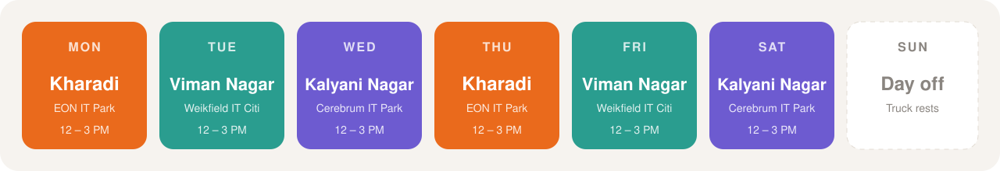
</div>

One truck, three IT hubs in east Pune, **12:00 – 3:00 PM, Monday to Saturday**. The site works out today's stop from the current time in Pune, so a visitor in another time zone still sees the right one. After 3 PM it shows the next stop instead.

<div align="center">
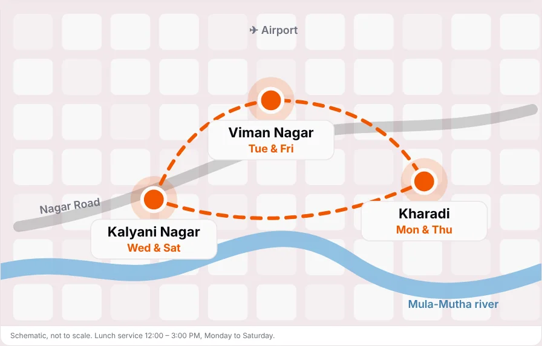
</div>

## 05 · The site

<table>
<tr>
<td width="50%">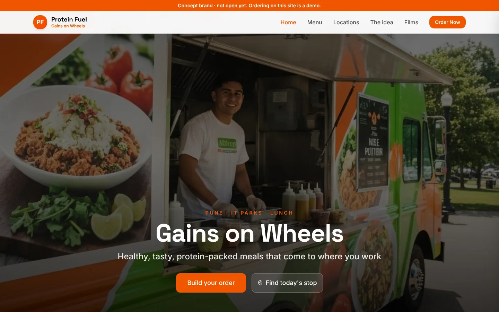<br/><sub><b>Home.</b> The brand film plays behind the hero. Build an order or find today's stop.</sub></td>
<td width="50%">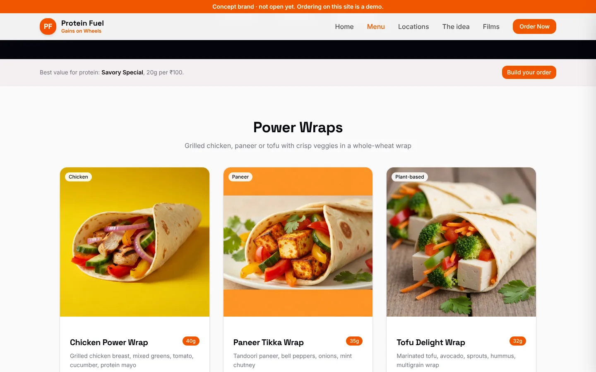<br/><sub><b>Menu.</b> Every card shows protein, calories and protein per ₹100.</sub></td>
</tr>
<tr>
<td width="50%">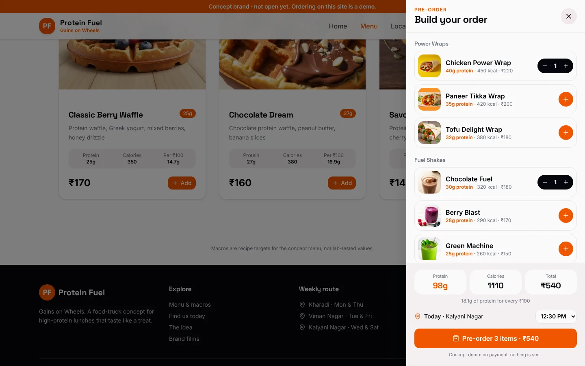<br/><sub><b>Build your order.</b> Totals for protein, calories and price update live. Pickup goes to today's stop.</sub></td>
<td width="50%">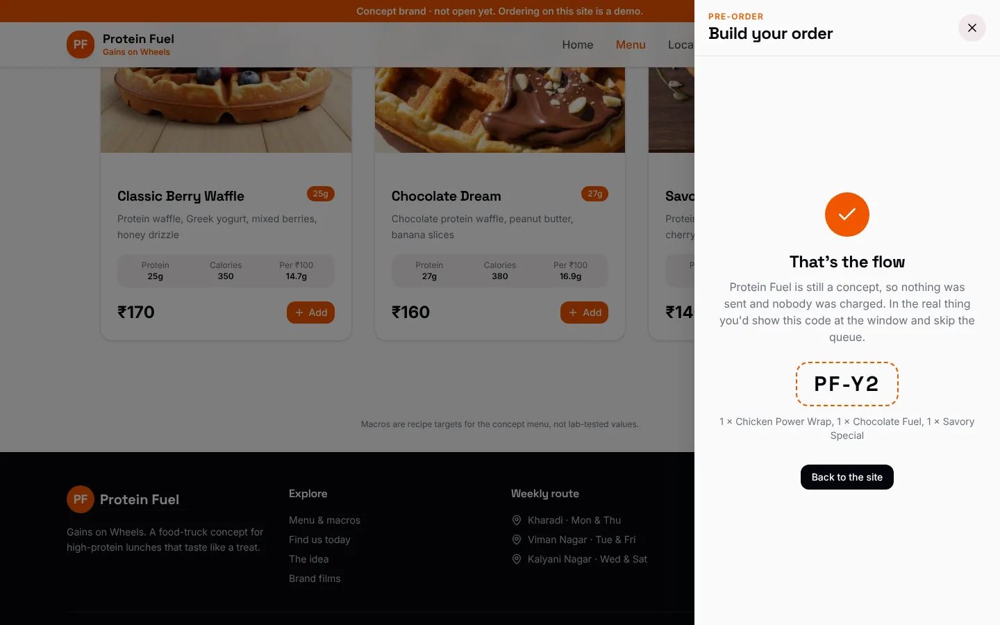<br/><sub><b>Pre-order done.</b> A pickup code, and a plain note that the demo sent nothing.</sub></td>
</tr>
<tr>
<td width="50%">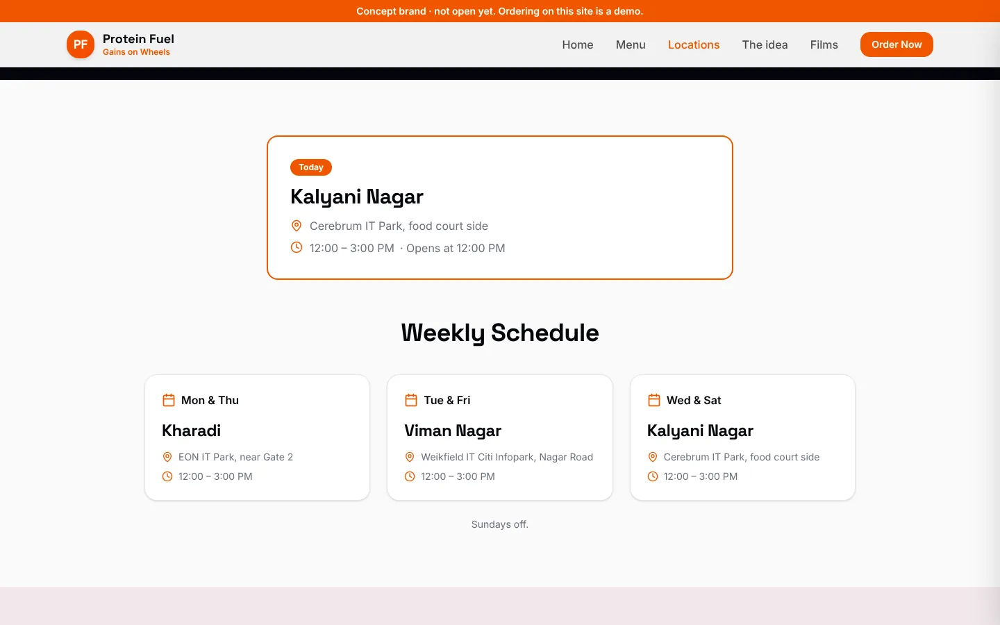<br/><sub><b>Find us today.</b> Live status (opens at noon, serving now, done for today) and the week.</sub></td>
<td width="50%">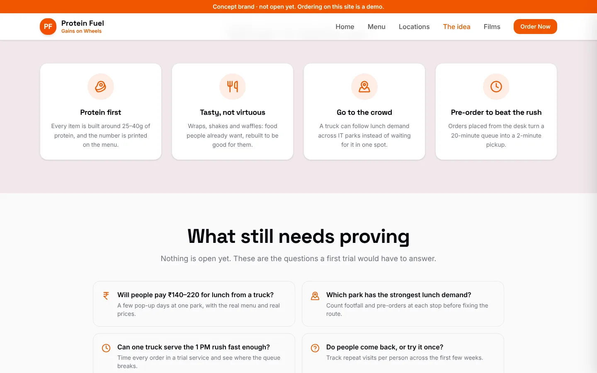<br/><sub><b>The idea.</b> What the concept bets on, and the questions a trial has to answer.</sub></td>
</tr>
</table>

<div align="center">
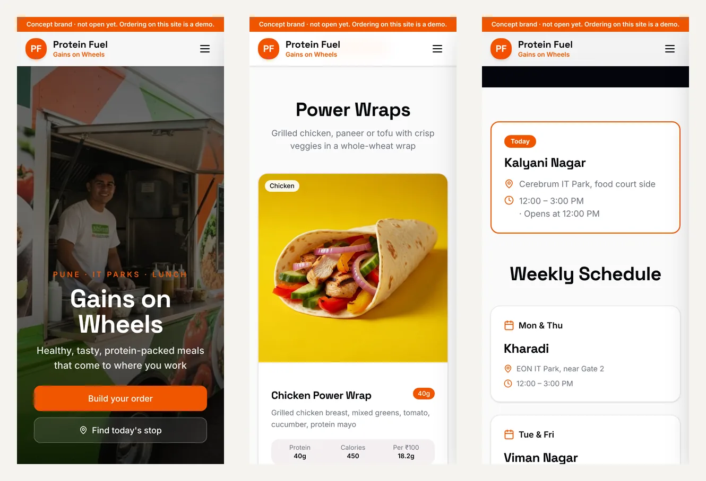
<br/><sub>The same site on a 390px phone.</sub>
</div>

**Pages:** `/` home · `/menu` menu and macros · `/locations` today's stop, schedule and route map · `/about` the idea · `/press` brand films and a fact sheet · `/tv-loop` both films back to back, full screen, for a screen on the truck.

## 06 · How it's built

| Layer | What's used |
|---|---|
| **Framework** | Next.js 16 (App Router), React 19, TypeScript in strict mode |
| **Styling** | Tailwind CSS 4, shadcn/ui primitives, Space Grotesk for headings and Inter for text |
| **Data** | Two plain files: [`lib/menu.ts`](lib/menu.ts) (items and macros) and [`lib/schedule.ts`](lib/schedule.ts) (stops, days, hours, and the Pune-time "where is the truck" logic) |
| **Ordering** | A React context and a slide-over drawer ([`components/order/`](components/order)). State lives in the browser only. |
| **Media** | Food images and truck concept art in `public/`, brand films on Vercel Blob, route map drawn in SVG |
| **Hosting** | Vercel, deployed from `main` |

The first version was generated with v0 in November 2025. In October 2026 it was reworked: the menu and schedule became data files, "Order Now" became a working pre-order flow, "today's stop" became live, invented testimonials and placeholder contact details came out, and the fonts that were declared but never applied now load.

## 07 · Where it stands

|  |  |
|---|---|
| **Status** | Concept. The website is live; the business isn't. |
| **Orders** | The pre-order flow is a demo. Nothing is sent and nothing is paid. |
| **Menu & prices** | Targets for a first menu, not tested recipes or costed prices. |
| **Locations** | The three IT parks are real places in east Pune. The truck isn't there. |
| **Checks** | Strict TypeScript and a production build. No automated tests. |

## 08 · What still needs proving

Nothing here has been tested with real customers. A first trial would need to answer:

1. **Will people pay ₹140–220 for lunch from a truck?** A few pop-up days at one park, with the real menu and real prices.
2. **Which park has the strongest lunch demand?** Count footfall and pre-orders at each stop before fixing the route.
3. **Can one truck serve the 1 PM rush fast enough?** Time every order in a trial service and find where the queue breaks.
4. **Do people come back, or try it once?** Track repeat visits per person across the first few weeks.

## 09 · Run it yourself

You'll need Node 20+ and pnpm.

```bash
git clone https://github.com/omkarpatilswork/v0-protein-fuel.git
cd v0-protein-fuel
pnpm install
pnpm dev            # http://localhost:3000
```

```bash
pnpm build          # type-checks and builds for production
```

## Repository map

```
v0-protein-fuel/
├── app/
│   ├── page.tsx            home
│   ├── menu/               menu and macros
│   ├── locations/          today's stop, schedule, route map
│   ├── about/              the idea and open questions
│   ├── press/              brand films and fact sheet
│   └── tv-loop/            full-screen film loop for the truck
├── components/
│   ├── order/              order context, drawer, Order Now and Add buttons
│   ├── today-stop.tsx      live "where is the truck" card
│   ├── route-map.tsx       SVG route schematic
│   └── navigation.tsx, footer.tsx, video-hero.tsx, ui/
├── lib/
│   ├── menu.ts             the menu, single source of truth
│   └── schedule.ts         stops, days, hours, Pune-time logic
├── public/                 food images and truck concept art
└── docs/                   README diagrams and screenshots
```

---

<div align="center">
<sub>A concept by <a href="https://www.omkarpatil.in">Omkar Patil</a> · #GainsOnWheels</sub>
</div>
